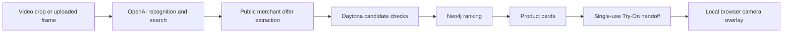

# Vesti

A working hackathon app and Chrome extension: select clothing in a YouTube video, find similar products, and preview a style with a local camera overlay. React, Fastify, TypeScript and Neo4j; one package and no separate task broker.

## Start here: judges and automated reviewers

Vesti connects visual inspiration to a product decision: select clothing, inspect similar finds, then open a private camera preview. Its MVP covers jackets, hoodies and T-shirts; it does not claim exact identity, garment fit or automated checkout.

- [Two-minute judge walkthrough](JUDGES.md)
- [Executable evaluation and fallback matrix](EVALUATION.md)
- [Contributor guidance](AGENTS.md)
- [Deployment](docs/DEPLOYMENT.md) · [Measured verification](docs/VERIFICATION.md)

No credentials: `npm ci`, then `npm run evaluate`. For the browser, run `npm run dev:demo`, pair using the terminal code and choose **Explore the demo collection**. This creates three labelled sample products without calling external providers. Installation and the initial camera-model download require network access.



The explicit demo path uses synthetic listings and no live receipts. A failed live run remains a failure; choosing demo starts a separate labelled experience.

## Run

Use Node 24 and Chrome 120 or newer.

```sh
npm ci
# Configure .env using .env.example; keep credentials server-side.
npm run assets
npm run build
npm run dev
```

Open http://localhost:5173 and enter the one-time pairing code printed in the terminal. A fresh clone has no credentials; configure your own `.env` for live mode. `LIVE_PROVIDER=auto` uses the OpenAI key when present. Standard `OPENAI_API_KEY` and the existing `OpenAI_API_Key` spelling are supported.

Click **Try a live search** for a quick demonstration: an original illustrated hoodie goes through real image recognition, public web search, merchant-page verification, Daytona candidate curation and graph ranking. Alternatively upload a frame and click the garment. **Explore the demo collection** works without model calls and clearly labels its illustrated products and sample prices.

## Chrome extension

1. Run the backend and build above.
2. Open `chrome://extensions`, enable Developer mode, choose **Load unpacked**, and select `D:\Vesti\dist\extension`.
3. Open a YouTube video in normal or theatre mode. Click the Vesti toolbar icon and pair with the terminal code. Each pairing consumes its code; the terminal prints a replacement.
4. Select a garment, accept the first-use crop disclosure, and click clothing inside the video. Escape cancels. Fullscreen must be exited first.
5. Review similar products and open a style preview in the web app.

The extension uses active-tab access, local storage and the side panel. Only loopback API host permissions are declared. It checks the active tab, playback frame and viewport before capturing, then crops locally; the full screenshot is never uploaded. Add the exact extension origin to `ALLOWED_ORIGINS` if your browser sends one that the pairing flow rejects.

## Live providers and product evidence

OpenAI mode uses the Responses API for structured image recognition and public web search. A bounded local worker checks cited URLs against the configured merchant hosts, robots rules, public DNS and HTTPS, then extracts real JSON-LD offers. Prices come from merchant data, not the model. Candidates then pass through a real Daytona sandbox before Neo4j ingestion. Its fixed, dependency-free worker enforces approved product URLs, matching category and source-run provenance, checks price/currency consistency, removes duplicate offers, and normalizes titles while preserving variant URLs and observed prices. Only its accepted output is persisted and ranked by parameterized Neo4j queries. Daytona is required for live searches; failures are surfaced rather than silently skipped. The sandbox receives only public product data, needs no outbound network, and is deleted after execution. The evidence panel records its role, sandbox ID, worker and data hashes, accepted/rejected counts, duration and cleanup status. Coverage is deliberately small: `shop.spacex.com` and `thegithubshop.com`. Searches can return partial or empty results. Products are similar finds, not claims of exact garment identity.

`LIVE_PROVIDER=sponsors` retains the original Nosana inference and Daytona retrieval path. Nosana recognition, Daytona sandbox execution and Neo4j were tested independently. The current Daytona account blocks public outbound retrieval at its account tier; sponsor discovery reports that error instead of pretending it ran. The default OpenAI path uses local retrieval followed by Daytona curation, which works within the existing account network restrictions. See [verification](docs/VERIFICATION.md).

## Camera and illustrations

Camera access starts only after **Enable camera**. MediaPipe model and WASM files are hosted locally; frames stay in the browser. Shoulder and hip landmarks drive a smoothed 2D overlay with scale, vertical position and mirror controls. Lost or unreliable tracking hides the overlay; leaving the page stops the camera.

No licensed transparent retailer garment assets were supplied. **Try-On** therefore uses an explicitly labelled original category illustration. It is not a rendering of that retailer's garment, a size recommendation, or a fit guarantee. Approved transparent PNG/WebP assets can be registered in `assets/garments/index.json`; see its README. Demo products have no merchant checkout links.

## Checks

```sh
npm run typecheck
npm test
npm run build
npm run test:graph
npm run smoke -- --vision
npx tsx scripts/openai-smoke.ts
npx tsx scripts/live-e2e.ts
```

Live checks use configured services and can incur small API charges. Reports under `docs/verification` contain outcomes and request receipts, never credentials. The live end-to-end test used an actual merchant product image and verified real Daytona execution and deletion, ranking, handoff and asset delivery. Physical webcam alignment and manual installation/capture in Chrome remain manual checks.

## Code map

| Folder               | Purpose                                                       |
| -------------------- | ------------------------------------------------------------- |
| `apps/api`           | Pairing, bounded jobs, provider adapters, handoffs and assets |
| `apps/web`           | Discovery, frame selection and local camera fitting room      |
| `apps/extension`     | MV3 capture, video selection and side panel                   |
| `packages/contracts` | Validated shared payloads, geometry and money                 |
| `packages/ui`        | Shared discovery screens and styles                           |
| `workers/discovery`  | Bounded merchant retrieval and JSON-LD extraction             |
| `graph`              | Parameterized graph ranking                                   |
| `tests`              | Security, geometry, extraction and journey checks             |

The API binds to loopback. It allows two running searches, eight queued jobs and a 90-second job deadline; crops expire after five minutes. Live search records and hashed sessions survive restarts through Neo4j. Demo state and single-use fitting-room handoffs are in memory. This is a local hackathon build, not a multi-tenant hosted service.

## Needle-inspired discovery interaction

Reference: https://github.com/Haoming9527/Needle (reviewed 31 October 2026). Vesti adopts the cursor-focused discovery pattern while retaining the requested clothing and camera-preview scope. The implementation and styling are original; no Needle source or branding was copied.

Reload the unpacked extension after rebuilding. On a YouTube watch page, activate Vesti using its toolbar icon and accept the crop disclosure. Click or right-click clothing to open the nearby **Find similar** popup. Choose that action to capture and search. Close returns to selection; Escape cancels. Keyboard crosshair selection remains available. Results retain real source/price evidence, filters, retailer links, and the fitting-room handoff. The right-click interaction is active only during Vesti selection; it does not install an always-on menu across websites.

The revised interface uses lilac surfaces, dark ink and citron accents, rounded result cards, and a wider desktop discovery panel. General-object shopping, voice, cart and simulated checkout were excluded per the user's clarification. The current automated suite and production build validate integration; the new injected popup still needs a manual unpacked-Chrome interaction check.

Each extension result has a **Try-On** button. It creates a single-use handoff and opens the Vesti website in a new tab with that product selected. Camera access starts only when the user enables it on the website.

Deployment: see [docs/DEPLOYMENT.md](docs/DEPLOYMENT.md) for the Vercel frontend, persistent HTTPS API, and extension API-origin configuration. Captured images are now decoded directly into bytes without data-URL fetches; connection errors identify the configured API address separately from capture errors.
