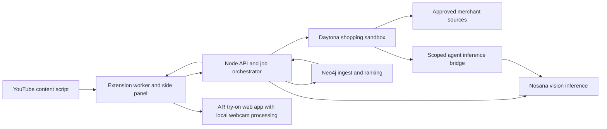

# Vesti product and engineering specification

Version 1.2 | 31 October 2026 | Implementation specification

Vesti turns a garment seen in a YouTube video into verified shopping recommendations and a live webcam preview. The hackathon MVP must complete the journey using real Nosana inference, real Daytona execution, and real Neo4j storage and ranking. This document defines proposed implementation behavior; it does not represent completed integrations or measured performance.

### Current setup status

The local backend `.env` now contains the Nosana API key, dedicated inference endpoint, model name, and deployment ID. Daytona API key and Neo4j URI/password fields are also populated. Credential values stay in `.env` and must not be copied into this specification. Nonempty configuration is confirmed; credential validity and application connectivity are not yet tested.

The supplied Nosana dashboard snapshot reports one running replica on an NVIDIA GeForce RTX 3090. This is deployment evidence supplied by the user, not an application inference test. The next milestone is validating the configured services, then implementing the end-to-end flow.

## 1 Product scope and success

The primary user watches a creator or actor, notices a jacket, hoodie, or T-shirt, and wants to find something similar without manually taking or uploading a screenshot. The user can preview its appearance on their torso and open the retailer listing.

P0 includes desktop Chrome, ordinary YouTube watch pages, one selected garment per search, supported merchants, a recommendation side panel, and a live 2D fitting room. Default results are visually similar alternatives. Exact identity requires independent product evidence.

P1 includes improved segmentation, sleeve occlusion, multiple selections, and comparable prices. P2 includes other video platforms, personalised preferences, affiliate links, multiple garments, and 3D cloth simulation. Mobile, Shorts, embedded players, picture-in-picture, checkout, sizing predictions, and arbitrary unrestricted retailer crawling are outside the MVP.

Success requires one uninterrupted live demonstration from video selection to a genuine merchant link, with evidence of all three sponsors. A cached demonstration alone does not pass. Product availability, source permissions, vision model readiness, and suitable overlay imagery are release gates.

## 2 User experience

### Activation and selection

1. The user opens a YouTube watch page and clicks the extension action. Explain once that a selected video crop is sent for recognition; webcam processing stays local.
2. Open the shopping side panel and enable a pointer overlay over the video. Show “Click a jacket, hoodie, or T-shirt”. Escape cancels selection.
3. On selection, pause playback briefly, hide the selection overlay, capture the visible frame, crop locally, and show the selected image with a click marker. Resume only if the video was playing and the user has not changed playback meanwhile.
4. Show progress through “Identifying clothing”, “Searching stores”, and “Ranking matches”. Each stage has a recoverable error state and Cancel.
5. Show the detected category and visible attributes. A low-confidence or ambiguous result offers reselection and editable category/colour before spending on discovery. User corrections carry distinct provenance.

### Recommendation panel

Show up to six ranked listings with image, title, merchant, observed price and currency, checked time, availability, match type, and up to three evidence-based reasons. Provide “Try on” and “View at retailer”. Never show an invented discount, price, stock state, or exact-match label. Unknown prices display “Check price at retailer”. Do not compare different currencies numerically without an explicit conversion feature.

Filters: category, colour, merchant, and price within one currency. Changing filters recomputes Neo4j ranking for the current candidate set; a separate action searches again. Empty results explain whether there were no matching listings or discovery could not finish.

### Fitting room

Open the Vesti AR try-on web app in a new tab from “Try on”, retaining a return path to the video. This provides room for the webcam and a clear camera-permission flow. Display the selected product, camera toggle, mirror toggle, scale adjustment, vertical adjustment, and reset. Explain “Approximate appearance preview; not a size or fit prediction”.

The web app runs on the configured Vesti HTTPS origin, or localhost during development. Transfer the selected product through a short-lived, single-use handoff code bound to the current session; never place sponsor credentials or image data in the URL. Exchange the code for a scoped fitting-room session, remove it from browser history, and apply a no-referrer policy. Validate session ownership when fetching the product and overlay asset. Camera permission belongs to the web-app origin and must be requested there. All webcam processing remains local to that tab.

Request camera access only after the user selects “Enable camera”; never request audio. Show guidance when shoulders or hips are outside the frame. Hide the garment when tracking becomes unreliable. Stop every camera track on close, explicit Stop, or session teardown. Handle denied access, absent camera, and device-in-use separately.

Keyboard users can move a crosshair within the video and press Enter to select. All controls have labels, visible focus states, and status announcements. Loading must not steal focus; reduced motion disables decorative animation.

### Mobbin review before UI implementation

Review Mobbin for comparable interfaces before implementing the extension and AR try-on web app. Research both surfaces separately, then define a shared Vesti visual system. This review is a required design task; it has not yet been performed.

| Surface | Patterns to research | Decisions the review must inform |
| --- | --- | --- |
| Chrome extension | Compact shopping panels, visual search, item selection, product cards, filters, progress, empty results, and recoverable errors | Narrow-panel layout, information density, navigation, selection feedback, price/merchant hierarchy, and placement of Try on versus retailer actions |
| AR try-on web app | Virtual fitting rooms where available; camera onboarding, live previews, beauty try-on, product customisation, and product-detail experiences as adjacent references | Camera consent, dominant preview area, product switching, adjustment controls, tracking guidance, preview-unavailable states, and return to the video |
| Cross-surface journey | Moving from discovery to a dedicated product experience and back | Continuity of the selected product, loading handoff, consistent labels, and preservation of the shopping session |

Use the Mobbin plugin's best-practices and search skills when conducting the review. Prefer actual desktop web and extension references when available. If Mobbin has limited extension or clothing AR coverage, explicitly identify that gap and use relevant adjacent patterns; do not present a mobile shopping screen as a proven extension layout or a camera screen as a working AR implementation.

Produce a concise reference board with three to five useful references per surface where coverage permits. Record each app/product name, Mobbin source link, relevant screen or flow, what interaction it demonstrates, what Vesti should adapt, and what does not transfer. Separate observed behavior from design inference. Use references to inform original Vesti layouts rather than copying another product's branding or assets.

The review deliverable is `docs/UI_REFERENCE_REVIEW.md`, accompanied by annotated wireframes for the extension panel and AR web app. Include the complete journey: select garment, identify, search, review recommendations, launch try-on, allow camera, adjust preview, and open retailer. Cover loading, ambiguity, service failure, camera denial, tracking loss, and missing overlay assets.

Before implementation, settle typography, spacing, colour, buttons, product cards, status messages, and accessibility behavior shared across the two surfaces. Evaluate the extension at narrow side-panel widths and the web app at laptop and wider desktop sizes. Each layout decision should tie to a Vesti user need and, where useful, a linked Mobbin reference. Completion requires both surfaces and their handoff to be represented, with limitations documented; collecting screenshots alone does not complete the review.

## 3 Architecture and ownership



Use React, TypeScript, Tailwind, and a Manifest V3 extension. Use a Node.js TypeScript API with schema validation, a bounded background job runner, the Daytona SDK, and the official Neo4j driver. Use MediaPipe Pose Landmarker and Canvas/WebGL for the fitting room. Package extension scripts, WASM, and model assets locally; do not load remote executable code.

For a single-instance hackathon deployment, keep active execution in the API process, persist job stages and results in Neo4j, and expose resumable polling. On process restart, mark interrupted jobs failed and clean up orphaned sandboxes. A separate durable queue is a production follow-up, not a hidden MVP dependency.

Only the backend holds sponsor credentials. The extension knows the backend URL and an ephemeral application session, never sponsor keys. The Daytona worker receives bounded job input and a short-lived bridge token, not Neo4j credentials or the master Nosana key.

## 4 Chrome capture and permissions

Use `activeTab`, `scripting`, `sidePanel`, and `storage` permissions, plus narrow backend host access. Inject only into the explicitly activated YouTube tab. The extension action supplies the user gesture for activation. Chrome documents that `captureVisibleTab` requires `activeTab` or broader access; this design uses the former. [Chrome tabs API](https://developer.chrome.com/docs/extensions/reference/api/tabs)

Capture only after checking the tab ID, window ID, URL, video rectangle, and navigation generation. A tab switch or navigation between click and capture invalidates the result. Do not depend on cross-origin video-to-canvas reads succeeding.

Geometry algorithm:

1. Record `clientX/clientY`, video bounding rectangle, viewport dimensions, intrinsic video dimensions, and playback time.
2. Compute the rendered content rectangle, excluding letterboxing. Reject clicks in black bars or outside the visible content.
3. Decode the captured bitmap locally. Use bitmap-to-viewport width and height ratios rather than assuming devicePixelRatio equals screenshot scale.
4. Crop to the visible video content and transform the click into normalized coordinates in that crop. If clipping prevents identifying the garment, ask the user to reposition the video.
5. Resize to at most 1280 pixels on the longest edge; transmit JPEG/WebP with a 2 MB request limit. Discard the original full-tab bitmap immediately after cropping.

Suppress the extension pointer before capture and avoid player controls covering the selected garment. Detect blank/protected frames and report capture unavailable; do not bypass restrictions. Normal and theatre modes are P0; fullscreen needs a separate layout/capture validation gate. Recompute geometry after side-panel resizing, scroll, zoom, or player changes.

## 5 Nosana integration

### Selected deployment

Use the dedicated Nosana Ollama deployment already configured locally, rather than the shared Nosana inference gateway. The model and deployment have been selected; image inference remains a validation gate.

| Item | Configured or supplied value |
| --- | --- |
| Template | Qwen 3.5 Models, 9B variant |
| Model | `qwen3.5:9b` |
| Container | `docker.io/ollama/ollama:0.32.6` |
| Deployment ID | `5xVgPuweBhxeqcNi3nRLv5i7hsjabc9SoS8ZmXtLjD1D` |
| Endpoint root | `https://4MKfKrceyf59hMXZwtHqsCiG5mT2aa9L91pT7ToydqBR.node.k8s.prd.nos.ci` |
| Exposed service | `server`, container port `11434` |
| Active GPU in supplied snapshot | NVIDIA GeForce RTX 3090 |
| Replica count in supplied snapshot | 1 of 1 |
| Deployment strategy in supplied snapshot | Infinite, with a displayed 6-hour timeout |
| Template health check | HTTP GET `/api/tags`, expected 200, non-continuous |

The deployment configuration lists multiple eligible GPU types; do not treat the current RTX 3090 as guaranteed for subsequent jobs. Confirm the actual GPU, endpoint, available memory, and timeout before each demonstration. The dashboard's relative countdown is not a permanent expiry timestamp. Do not interpret “Infinite” as proof that the current job or endpoint will run indefinitely.

### API adapter and authentication

`NOSANA_BASE_URL` stores the endpoint root without `/api` or `/v1`. The initial backend adapter will use native Ollama HTTP routes: GET `/api/tags` to inspect available models and POST `/api/chat` for inference. Request non-streaming JSON with the configured model and validate the returned content. Ollama supports JSON or a JSON schema through `format`. [Ollama model listing](https://docs.ollama.com/api/tags) · [Ollama chat API](https://docs.ollama.com/api/chat)

If an OpenAI-compatible client is used instead, derive its base URL by appending `/v1` exactly once and use the compatible request format. Do not mix native and compatible message/image payloads. Compatibility covers a subset of the OpenAI API and does not require an OpenAI account or API key. [Ollama compatibility documentation](https://docs.ollama.com/api/openai-compatibility)

Keep `NOSANA_API_KEY` on the backend. Verify the dedicated endpoint's actual authentication requirements before attaching credentials; a Nosana platform key must not be assumed to secure or authenticate a raw Ollama server. The supplied job definition does not declare an authentication layer. Confirm gateway protection or an appropriate access-control layer before exposing the application to other users. Never send the platform key to merchant pages, the extension, or unverified redirects.

### Validation and inference limits

1. Check the endpoint's authentication contract and reachability, then confirm `/api/tags` includes `qwen3.5:9b`. A successful health check alone does not prove image support or model readiness.
2. Run a real image request containing a selected garment and click target. Record actual serving model, deployment/job correlation, response shape, and timing without logging the image or secrets.
3. Validate structured attributes and selection accuracy on the labelled cases in section 13. Include multiple people, an ambiguous click, and unsupported clothing.
4. Start with one in-flight Nosana inference request and an explicit 4K context; test 8K only if needed. These are proposed tuning settings, not settings already applied to the deployment. The two-search backend limit does not imply two simultaneous GPU requests; vision and agent planning share a queue.
5. Measure cold and warm latency separately. Warm the model before the demo, then check against the 25-second recognition budget. If the model fails quality or timing gates, tune the configuration or deliberately revise the Nosana deployment; do not silently substitute another provider.

A text-only success does not satisfy garment recognition. Handle endpoint changes, stopped jobs, unloaded models, and expired execution windows as explicit service states. Refresh `.env` from the deployment connection panel when the endpoint changes, then restart/reload backend configuration and repeat the smoke test.

Send the unmarked image, normalized click coordinates, and optionally a separate annotated image. Ask for the garment containing the click, an estimated bounding box, visible attributes, uncertainty, and concise discovery terms. Do not infer identity, exact brand, or fabric composition from appearance alone. Material is a tentative visual observation unless a merchant later confirms it.

Validate output against a schema. Require a supported category or `unknown`, bounded coordinates, bounded strings, and finite confidence values. Confidence is an uncalibrated model signal, not a statistical probability. A box not containing the click or conflicting garment categories triggers confirmation. Allow one bounded repair attempt for malformed output, then surface an inference error.

Use the same `qwen3.5:9b` deployment for text planning initially, once its structured action output is tested. If `NOSANA_AGENT_MODEL` is blank, resolve it to `NOSANA_VISION_MODEL`. A separately selected planning model must be available on its configured serving endpoint; setting a model name alone does not deploy it.

## 6 Daytona product discovery

Use the stable Daytona SDK surface selected and pinned during implementation. Authenticate using `DAYTONA_API_KEY`; do not mix alpha v2 examples with the stable SDK. The current stable documentation includes environment-based authentication and sandbox execution. [Daytona authentication](https://www.daytona.io/docs/en/authentication/) · [Daytona quickstart](https://www.daytona.io/docs/en/)

Create a job-scoped sandbox from a pinned image/snapshot containing Node, Playwright, browser dependencies, and a fixed worker. The sandbox performs real search, page retrieval, extraction, and URL checks. It is not merely a wrapper around precomputed listings.

The worker runs a bounded AI-assisted loop: request search terms from a Nosana-backed bridge, execute approved merchant adapters, inspect structured observations, and revise the search once if results are inadequate. Maximum three planned actions, two merchants concurrently, ten inspected listings per merchant, and one sandbox per job. The planner produces validated action objects, never arbitrary shell commands. Prefer deterministic extraction from official APIs, permitted feeds, or structured page data over model interpretation of prices.


The bridge is reachable over authenticated HTTPS and accepts only the current job token, approved model, capped prompt sizes, and bounded request count. A local development API needs a deliberately configured reachable bridge before cloud workers can call it. Never expose an unauthenticated localhost tunnel. An alternative implementation may keep inference orchestration on the backend while the sandbox executes each validated discovery action.

Start with two merchant adapters whose access method has been verified. Each adapter defines hostnames, search URL/API, extraction rules, supported locale/currency, image use constraints, rate limits, and a live validation fixture. Merchant selection remains an implementation gate; do not assume a specific retailer permits scraping. CAPTCHA, login walls, denied access, and explicit blocking end that adapter's attempt without bypass.

For each result, store source URL, final URL, merchant, title, product identifier where available, image URL, observed price/currency, availability, capture time, and extraction provenance. Verify the destination is a product page, not simply an HTTP 200 search page or bot challenge. Sanitize content and deduplicate canonical merchant/product/variant keys. Do not strip query parameters that identify variants.

Use approved public HTTPS destinations only. Validate every redirect and resolved address to block loopback, private networks, metadata endpoints, and DNS rebinding. Treat page text as untrusted data, never tool instructions. Remove scripts from extracted content.

Always dispose of the sandbox after completion, failure, or cancellation. Set a provider-supported lifetime limit as a second safeguard and run orphan cleanup. The initial search deadline is 90 seconds, including cleanup initiation; a provider operation that outlives cancellation must still be reconciled.

## 7 Shared data contracts

These are application contracts, not assumed vendor response formats. Use ISO 8601 UTC timestamps, opaque UUIDs, normalized attribute keys, and schema version 1.

```typescript
type Category = 'jacket' | 'hoodie' | 'tshirt' | 'unknown';
type Attribute = {
  key: string; kind: 'colour' | 'pattern' | 'style' | 'material' | 'category';
  value: string; confidence: number | null;
  source: 'vision' | 'merchant' | 'user'; evidence: string | null;
};
type Garment = {
  id: string; category: Category;
  box: { x: number; y: number; width: number; height: number };
  attributes: Attribute[]; confidence: number | null;
  modelId: string; providerRequestId: string | null;
};
type Listing = {
  id: string; productKey: string; title: string; merchantDomain: string;
  canonicalUrl: string; imageUrl: string | null;
  priceDecimal: string | null; currency: string | null;
  availability: 'in_stock' | 'out_of_stock' | 'unknown';
  checkedAt: string; attributes: Attribute[];
  sourceRunId: string; verification: 'verified' | 'unverified';
};
type Recommendation = {
  listingId: string; score: number; matchType: 'exact' | 'similar';
  reasons: { attributeKey: string; evidence: string }[];
  rankingVersion: string;
  overlayStatus: 'ready' | 'preparing' | 'unavailable';
};
```

Require currency whenever price is known. Store money as a decimal string or integer minor units with currency precision, never floating-point arithmetic. Missing images disable visual preview rather than inventing an image. Vision-estimated and merchant-confirmed properties remain distinguishable.

## 8 Neo4j data model and ranking

MCP is optional. The application will use `neo4j-driver` with a database URI, username, password, and database name. The official driver directly supports Node/TypeScript applications. [Neo4j JavaScript driver](https://neo4j.com/docs/javascript-manual/current/)

Neo4j MCP is a separate bridge for MCP clients and still needs an underlying Neo4j database. It may be useful for developer graph inspection, but is not a prerequisite for Vesti or a replacement for hosting the database. If enabled later, configure it separately with the supported version's requirements and restricted access. [Neo4j MCP introduction](https://neo4j.com/docs/mcp/current/)

Proposed graph:

```text
(SearchSession)-[:HAS_RUN]->(DiscoveryRun)
(SearchSession)-[:SELECTED]->(Garment)
(Garment)-[:HAS_ATTRIBUTE {confidence, source}]->(Attribute)
(DiscoveryRun)-[:FOUND]->(Listing)
(Listing)-[:OFFERS]->(Product)
(Listing)-[:SOLD_BY]->(Merchant)
(Product)-[:BY_BRAND]->(Brand)
(Product)-[:HAS_ATTRIBUTE {confidence, source, evidence}]->(Attribute)
(Product)-[:IN_STYLE]->(Style)
(Garment)-[:IN_STYLE]->(Style)
(SearchSession)-[:RECOMMENDS {score, version, reasonsJson}]->(Listing)
```

Create uniqueness constraints on all entity IDs and normalized attribute/style/merchant keys. A Product is merchant-scoped unless a trustworthy shared identifier proves cross-merchant identity. Listings represent offers/variants and DiscoveryRuns preserve observation provenance. Brand nodes are created only from evidence. Use parameterized Cypher, bounded result counts, transactional ingestion, and idempotent MERGE keys. Store raw images outside the graph; never place secrets in nodes.

Ranking v1 uses visible attributes as an explainable visual-similarity proxy. It does not claim image-embedding similarity. Compute component scores in Cypher from shared relationships, then persist scores and reasons. The graph query must determine the order rather than merely store a backend-computed list.

| Component | Weight | Proposed rule                                 |
| --------- | -----: | --------------------------------------------- |
| Category  |   0.35 | Exact supported category agreement            |
| Colour    |   0.25 | Normalized colour overlap                     |
| Pattern   |   0.15 | Shared pattern, penalizing explicit conflicts |
| Style     |   0.15 | Shared Style relationships                    |
| Material  |   0.10 | Only when source evidence is adequate         |

Compute a confidence-weighted overlap per component in [0,1]. Exclude attributes unknown on the garment from the denominator; missing product evidence scores zero for an active component. If no useful garment evidence remains, require reselection. Clamp the final score to [0,1]. Filter known category mismatches, unverified URLs, and known out-of-stock offers before ranking. Price filters exclude unknown price rows but explain the exclusion. Tie-break by recent verification and stable listing ID.

A representative traversal is `SearchSession → SELECTED → Garment → HAS_ATTRIBUTE ← Product ← OFFERS ← Listing ← FOUND ← DiscoveryRun ← HAS_RUN ← SearchSession`. Restrict candidates to that session's run to prevent cross-user result leakage. Style contributes a separate shared-neighbour traversal. Return the matched attributes with their evidence for deterministic explanations such as “Same jacket category, black colour, and hooded style”. Do not generate reasons unsupported by the graph.

Only mark an exact match when independent evidence establishes that the garment in the video is the particular merchant product, such as a creator's verified item link plus matching identifier. Appearance or a visible logo alone is insufficient. Graph embeddings/vector indexes are P1 if a real image encoder and measured benefit are added.

## 9 Live 2D garment overlay

MediaPipe supplies body landmarks and supports browser video processing; detection calls can block the UI, so isolate inference in a worker where supported and otherwise throttle it. [MediaPipe web guide](https://developers.google.com/edge/mediapipe/solutions/vision/pose_landmarker/web_js)

Pose tracking does not isolate a garment from a merchant photo. Asset preparation is a separate requirement: prefer an authorized transparent front-view product asset; otherwise use a validated garment segmentation/background-removal pipeline and inspect quality. A photograph of a model must not be pasted whole onto the user. Store asset source, license/access basis, product ID, preparation method, and shoulder/hem anchors.

The minimum demo needs a genuine discovered listing with an approved usable overlay asset. Manually preparing that merchant asset is acceptable for the hackathon if disclosed; it must correspond to the selected product. Arbitrary listings without assets show “Preview unavailable” while retaining the purchase action. A generic category silhouette, if offered, is explicitly labelled an illustration and does not satisfy the selected-product demo.

Map left/right shoulders and hips to a torso quadrilateral. Scale from shoulder width and shoulder-to-hip length, rotate with the shoulder vector, and use asset anchors for neckline alignment. Apply timestamp-aware smoothing, mirror the video and landmarks consistently, and retain user offsets. Hide or fade after 300 ms of unreliable tracking and reacquire smoothly. Warn on a near-sideways pose where the flat overlay cannot represent the garment.

Target 24 FPS rendering and at least 15 pose updates per second at 640×480 on the demo laptop; measure before claiming success. Do not queue stale camera frames. No webcam frames are sent to the backend. Sleeve motion, body depth, cloth drape, true fit, and realistic occlusion remain limited in P0.

## 10 Backend endpoints and job lifecycle

| Endpoint                        | Behavior                                                                                         |
| ------------------------------- | ------------------------------------------------------------------------------------------------ |
| `POST /v1/searches`             | Validated multipart crop plus normalized click, video ID/time, locale; returns 202 and search ID |
| `GET /v1/searches/:id`          | Stage, timestamps, garment, recommendations, warnings, and safe error information                |
| `POST /v1/searches/:id/confirm` | Correct or confirm an ambiguous garment and continue discovery                                   |
| `POST /v1/searches/:id/rank`    | Apply validated filters to the session's graph candidates                                        |
| `DELETE /v1/searches/:id`       | Cancel execution and initiate temporary-data cleanup                                             |
| `GET /v1/listings/:id/overlay`  | Return authorized overlay asset metadata, or unavailable                                         |
| `GET /health/live`              | Process liveness without secrets                                                                 |
| `GET /health/ready`             | Configuration/dependency status; no billable inference on every probe                            |
| `GET /v1/admin/runs/:id`        | Restricted sponsor evidence and timing dashboard data                                            |

State sequence: `created → identifying → awaiting_confirmation? → discovering → ranking → completed`. Terminal alternatives: `failed`, `cancelled`, or `partial`. Partial means some merchant tasks failed but verified candidates were successfully ranked in Neo4j. A Nosana or Neo4j failure must not be reported as a completed sponsor-backed search.


Use session-scoped authorization on every resource, including images and admin logs. Accept an idempotency key on creation. Poll every second while active, backing off to three seconds; re-opening the panel retrieves the current state. The service worker does not own long-running jobs. Include `code`, `stage`, `retryable`, `message`, and `requestId` in errors. Retry transient errors at most once with jitter and within the total deadline; never retry authorization failures as if transient.

Initial limits: two concurrent searches per backend instance, one active search per session, ten starts per session per ten minutes, and 90 seconds per search. Suggested stage budgets are 25 seconds for recognition, 55 for discovery, and 10 for ingest/ranking; these are engineering targets to revise using real measurements. Queue time is visible. Cancellation discards late results and revokes worker tokens.

## 11 Security and retention

The local demo binds to loopback. A hosted deployment requires HTTPS, application authentication, ownership checks, and exact allowed origins. CORS alone is not authentication. Do not ship a shared permanent backend secret in the extension. Pair a local extension through a short-lived one-time code or use authenticated user sessions for a hosted service.

Drop video crops from application memory after identification, with a maximum five-minute TTL; do not persist full-tab screenshots. Sponsor-side retention depends on the chosen service/deployment and must be checked before distribution. Keep job metadata and user-linked graph data for 24 hours by default; keep reusable public listing observations up to seven days with checked timestamps. Implement expiry cleanup for sessions, relationships, assets, and sandbox artifacts without deleting shared nodes still in use. No face recognition or body measurements are required.

Redact credentials, authorization headers, image bodies, raw merchant HTML, and personal query parameters from logs. Limit uploaded image dimensions as well as bytes. Merchant content cannot choose network destinations outside adapter policies, database queries, tool permissions, or executable commands. Product-image fetching uses the same SSRF defenses as discovery.

## 12 Failure behavior and evidence

| Failure                              | User outcome                                                         |
| ------------------------------------ | -------------------------------------------------------------------- |
| Blank capture or moved tab           | Ask for reselection; no external inference                           |
| Uncertain garment                    | Show crop and ask to confirm/edit                                    |
| Nosana unavailable or no image model | Recognition unavailable; no fabricated attributes                    |
| One merchant blocked                 | Continue approved sources and disclose incomplete coverage           |
| Daytona unavailable                  | Search unavailable; prior results only if explicitly labelled cached |
| Neo4j unavailable                    | Recommendations unavailable; retain retryable job evidence           |
| Missing product asset                | Purchase available, fitting preview unavailable                      |
| Camera denied or tracking lost       | Explain recovery; stop/hide overlay appropriately                    |

For each search, collect actual timestamps, sanitized provider/model/request IDs when supplied, Daytona sandbox ID and exit status, source URLs, extraction counts, graph write counts, query version, ranking components, cleanup state, and measured stage durations. If a provider supplies no request ID, label the application correlation ID correctly. Never invent a provider receipt.

The judge dashboard shows three sponsor stages with states `not_started`, `running`, `succeeded`, or `failed`, plus drill-down evidence. Include graph query output and a graph view of the actual current run. Clearly distinguish fresh calls from cache hits. Cost reporting uses returned usage or observed billing evidence; otherwise label cost unknown.

## 13 Verification and release gates

| Gate             | Acceptance                                                                                                                                                             |
| ---------------- | ---------------------------------------------------------------------------------------------------------------------------------------------------------------------- |
| Capture          | Normal/theatre mode, zoom 80/100/125%, two display scales, scroll, and tab-switch race yield the correct crop or a clear rejection                                     |
| Recognition      | At least 20 labelled jacket/hoodie/T-shirt click cases, including multiple people; target at least 80% correct selected category and no silent wrong-person acceptance |
| Discovery        | Two approved live adapters; genuine product-page destinations, accurate extracted fields, null for missing values, and cleanup on failure                              |
| Graph            | Repeated ingestion produces no duplicate keys; changing a matching relationship predictably changes ranking and explanation                                            |
| AR               | A real product asset follows a live user through translation, scale, and modest rotation; tracking loss hides it; camera stops on exit                                 |
| Resilience       | Inject malformed vision JSON, provider timeout, blocked merchant, graph outage, restart, cancellation, and stale result delivery                                       |
| Security         | Secret scan of extension bundle, cross-session access denial, malicious URL/redirect rejection, and no webcam traffic                                                  |
| Sponsor evidence | Fresh Nosana inference, Daytona execution, and Neo4j query/write are visible for one successful run                                                                    |

Use unit tests for geometry, schemas, money parsing, ranking components, and URL policies; integration tests against a disposable Neo4j database and real provider smoke tests when configured; browser tests for selection and permissions. Test fixtures may be synthetic but must never appear as successful live sponsor evidence. Record actual measured outcomes against the targets above.

Demo sequence: open a real video, select a jacket, inspect the identified garment, show Daytona discovery logs, show Neo4j nodes/query results, inspect real recommendations, enable camera, move while the garment follows, open the retailer, then show sponsor evidence for the same search ID.

## 14 Delivery plan and repository layout

1. Validate the populated local configuration: real image inference on the selected Nosana deployment, Daytona browser task, Neo4j write/read, two viable merchant sources, and one authorized overlay asset. Nosana model selection and endpoint entry are complete; live integration tests remain pending.
2. Review Mobbin for extension and AR web-app patterns. Deliver the reference review, both wireframes, shared visual system, and cross-surface handoff design before UI implementation. Backend integration work may proceed alongside this review.
3. Build shared schemas, backend configuration validation, job state, provider adapters, graph constraints, and evidence logging.
4. Implement extension activation, reliable capture geometry, progress polling, garment confirmation, and results using the reviewed layouts.
5. Complete sandbox discovery, graph ranking, cancellation, cleanup, and verified purchase links.
6. Implement the AR web app, scoped session handoff, local camera tracking, asset placement, tracking recovery, and accessible controls.
7. Run acceptance checks, measure latency/FPS, rehearse the live demo, and document unresolved limitations.

Suggested structure:

```text
apps/extension/        content script, worker, side panel, try-on handoff
apps/web/              AR try-on web app and local camera processing
apps/api/              routes, jobs, configuration, authentication
packages/contracts/   validated shared data schemas
packages/providers/   Nosana, Daytona, Neo4j adapters
workers/discovery/    fixed sandbox runner and merchant adapters
graph/                constraints and versioned Cypher queries
assets/garments/       authorized overlays and provenance
tests/                unit, integration, and browser checks
docs/                 specification, setup, and demo runbook
```

## 15 Configuration and next setup steps

The root `.env` is for the backend only and is ignored by Git. `.env.example` is a shareable template and must never be regenerated by copying the populated `.env`. Local checks confirm that Nosana configuration, the Daytona API key, and Neo4j URI/password fields are nonempty. These checks did not authenticate to any provider. Load environment variables before backend startup and validate mandatory settings with errors that name missing variables without exposing their values.

| Setting                                              | Required information                                   |
| ---------------------------------------------------- | ------------------------------------------------------ |
| `NOSANA_API_KEY`                                     | Populated locally; validate use against the intended Nosana API |
| `NOSANA_BASE_URL`                                    | Dedicated Ollama endpoint root configured; connectivity untested |
| `NOSANA_VISION_MODEL`                                | Set to `qwen3.5:9b`; image inference validation pending |
| `NOSANA_DEPLOYMENT_ID`                               | Configured deployment identifier for evidence and lifecycle tracking |
| `NOSANA_AGENT_MODEL`                                 | Optional separate planning model ID                    |
| `DAYTONA_API_KEY`                                    | Populated locally; sandbox execution validation pending |
| `DAYTONA_TARGET`, `DAYTONA_SNAPSHOT`                 | Optional confirmed region and prepared worker snapshot |
| `NEO4J_URI`                                          | Populated locally; connection validation pending |
| `NEO4J_USERNAME`, `NEO4J_PASSWORD`, `NEO4J_DATABASE` | Password populated; validate credentials and selected database together |
| `ALLOWED_ORIGINS`                                    | Exact extension origin once its ID is known            |
| `MERCHANT_ALLOWED_DOMAINS`                           | Approved adapter hosts; empty disables discovery       |

Use the existing configured Neo4j connection for the integration check; creating a new instance is not the default next step. Verify authentication, database selection, and write/read permissions using an isolated test record with cleanup. An Aura management API key is not a substitute for the database password. MCP setup is not needed for this architecture.

Remaining gates are dedicated-endpoint authentication and image inference validation, Daytona sandbox execution, Neo4j connectivity and ranking implementation, merchant access agreements and adapters, product overlay asset preparation, the backend's hosting/session strategy, and real performance measurements. Configuration is ready for those checks; the application is not yet implemented or demonstrated end to end.
